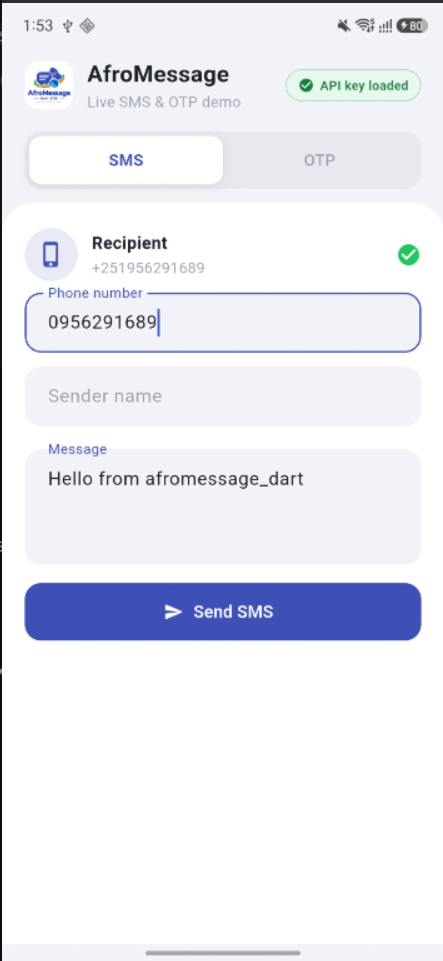
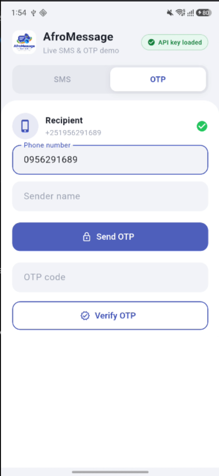

<p align="center">
  
  &nbsp;&nbsp;
  
</p>

# afromessage_dart

Unofficial Dart/Flutter client for [AfroMessage](https://afromessage.com) — a popular SMS gateway for **Ethiopia**.

AfroMessage lets apps reach Ethiopian mobiles (Ethio Telecom and Safaricom) over a simple HTTP API: transactional texts, marketing/bulk campaigns, and one-time passwords for signup or 2FA. This package wraps that API so you can send a message, fire a bulk campaign, challenge a phone with an OTP, and verify the code — without hand-writing request URLs, auth headers, or phone-number formatting.

It works anywhere Dart runs (Flutter apps, servers, CLIs). For production mobile apps, keep your API token on a **backend** and call AfroMessage from there.

Official API reference: [AfroMessage developers](https://afromessage.com/developers)

## Install

```bash
dart pub add afromessage_dart
# or in Flutter:
flutter pub add afromessage_dart
```

## Credentials (required vs optional)

From your [AfroMessage dashboard](https://api.afromessage.com/):

| Field | Required? | Config property | Notes |
| --- | --- | --- | --- |
| API token | **Required** | `apiKey` | Bearer token. Requests fail without it. |
| Sender name | **Recommended** | `senderName` | Verified sender label. Many accounts need this. |
| Identifier ID | **Optional** | `identifierId` | System short-code / `from`. Only if you have **multiple** identifiers. |
| Base URL | Optional | `baseUrl` | Defaults to `https://api.afromessage.com/api`. |

```dart
final sms = AfroMessage(
  AfroMessageConfig(
    apiKey: 'YOUR_TOKEN',          // required
    senderName: 'YOUR_SENDER',     // recommended
    // identifierId: 'YOUR_ID',   // optional — multi-identifier accounts only
  ),
);
```

> **Security:** Do not ship your API token inside a public Flutter/mobile app. Prefer calling AfroMessage from your backend and expose only your own authenticated endpoints to clients.

## Phone numbers

Numbers are normalized to E.164 (`+251XXXXXXXXX`) before each request.
Ethio Telecom (`09` / `9`) and Safaricom Ethiopia (`07` / `7`) are both accepted:

`0912345678`, `912345678`, `0712345678`, `+251912345678`, `251712345678`, etc.

Invalid numbers throw [AfroMessageException].

## Usage

```dart
import 'package:afromessage_dart/afromessage_dart.dart';

final sms = AfroMessage(
  AfroMessageConfig(
    apiKey: 'YOUR_TOKEN',
    senderName: 'YOUR_SENDER',
    logLevel: AfroMessageLogLevel.info, // see Logging below
  ),
);

try {
  final sent = await sms.sendSms(
    SendSmsRequest(
      to: '0912345678',
      message: 'Hello from Flutter/Dart',
    ),
  );

  if (sent.isSuccess) {
    print(sent.response?.messageId);
  } else {
    print(sent.error); // API acknowledge error detail
  }

  final otp = await sms.sendSecurityCode(
    SendSecurityCodeRequest(
      to: '0912345678',
      length: 6,
      postfix: 'is your verification code', // spaced automatically (sa=1)
    ),
  );

  final verified = await sms.verifyCode(
    VerifyCodeRequest(to: '0912345678', code: '123456'),
  );
} on AfroMessageException catch (e) {
  // validation, network, HTTP, or (optional) acknowledge errors
  print(e); // includes method, endpoint, status, body when available
} finally {
  sms.close();
}
```

## Logging

Turn on logs while integrating. The **API key is never logged**.

| Level | What you get |
| --- | --- |
| `off` (default) | Silent |
| `error` | Failures only |
| `info` | Request lifecycle + success/failure |
| `debug` | Sanitized payloads + response bodies |

```dart
final sms = AfroMessage(
  AfroMessageConfig(
    apiKey: 'YOUR_TOKEN',
    senderName: 'YOUR_SENDER',
    logLevel: AfroMessageLogLevel.debug,
    // Optional: wire into your own logger
    // logger: (level, message, {error, stackTrace, context}) { ... },
  ),
);
```

## Error handling

| Situation | Behavior |
| --- | --- |
| Missing `apiKey` / bad phone / missing fields | Throws [AfroMessageException] |
| Network / HTTP client failure | Throws [AfroMessageException] (`cause` set) |
| Non-2xx HTTP | Throws [AfroMessageException] (`statusCode`, `body`) |
| HTTP 200 but `acknowledge != success` | Returns response (`isSuccess == false`, see `error` / `raw`). Set `throwOnApiError: true` to throw instead. |

```dart
AfroMessageConfig(
  apiKey: 'YOUR_TOKEN',
  senderName: 'YOUR_SENDER',
  throwOnApiError: true, // prefer exceptions over failed response objects
  logLevel: AfroMessageLogLevel.info,
);
```

Always catch [AfroMessageException] around live calls. Inspect `e.endpoint`, `e.method`, `e.statusCode`, `e.acknowledge`, and `e.body` when debugging.

## API map

| Method | HTTP | Endpoint |
| --- | --- | --- |
| `sendSms` | POST | `/api/send` |
| `sendBulkSms` | POST | `/api/bulk_send` |
| `sendSecurityCode` | GET | `/api/challenge` |
| `verifyCode` | GET | `/api/verify` |

## Flutter vs Dart

This is a **pure Dart** package (HTTP only). It works in Flutter apps, Flutter web, Dart CLI, and server-side Dart — no platform plugins needed.

## Demo app

A Flutter sample lives in [`demo_app/`](demo_app/) on GitHub (not published to pub.dev). It has **SMS** / **OTP** tabs, loads `API_Key` + `PHONE` from `.env` (key shown only as a green/red badge), and makes live AfroMessage calls.

```bash
cd demo_app
flutter pub get
flutter run
```

> Demo only — call AfroMessage from your backend in production. Never commit API keys.

## Owner & maintainer

**Miftah Fentaw** ([@Miftah-Fentaw](https://github.com/Miftah-Fentaw))

## Contributing

Contributions are welcome. See [CONTRIBUTING.md](CONTRIBUTING.md) for guidelines.

## License

This project is licensed under the [BSD 3-Clause License](LICENSE).
